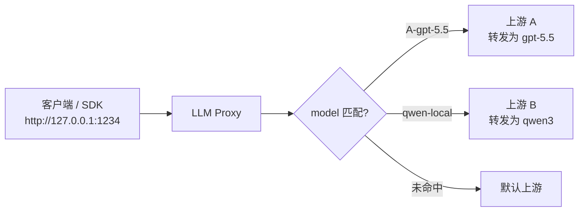
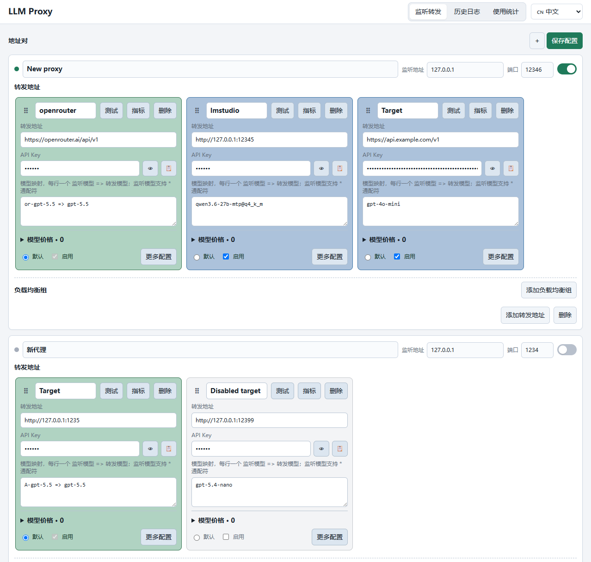
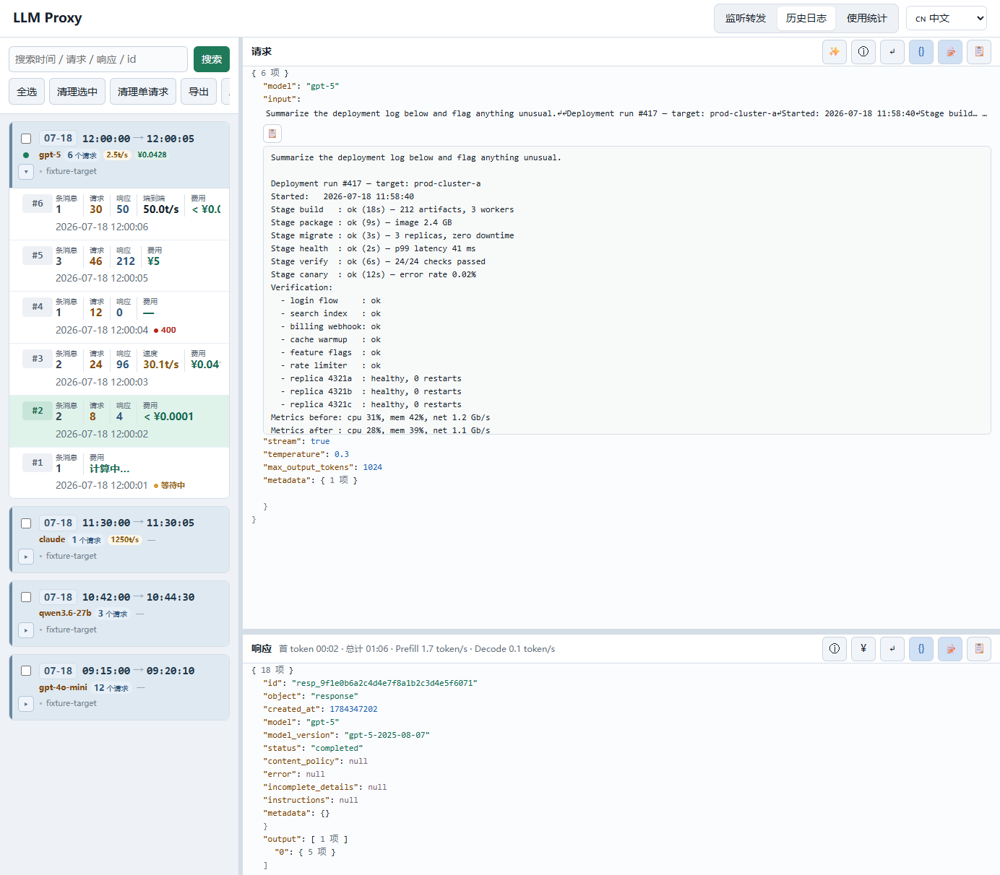
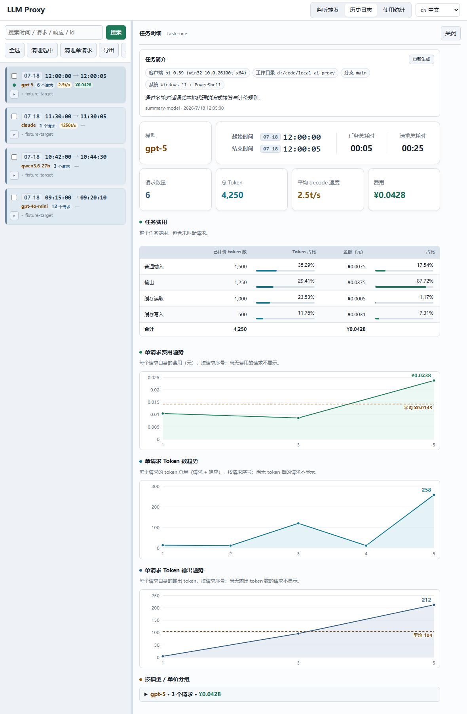
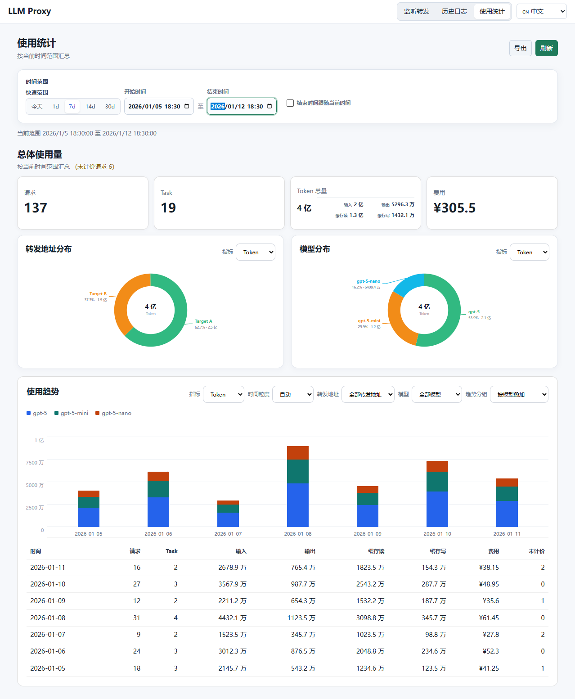

# LLM Proxy

[English](README.en.md) | 中文

LLM Proxy 是一个运行在本机的 LLM 网关和可视化控制台。它把 OpenAI 兼容接口或 Claude Messages 接口统一暴露为本地地址，让你可以按模型选择上游，并在浏览器中查看完整请求记录。

## 工作方式

客户端只需要连接本地代理地址。代理读取请求中的 `model`，依次检查模型路由规则；命中后转发到对应上游并可改写模型名，没有命中则使用默认上游。



## 模型路由



| 功能 | 说明 |
| --- | --- |
| 多个代理端口 | 在一个控制台中创建多个本地监听地址，每个地址可连接不同上游。 |
| 多个上游 | 一个代理可以配置多个上游，并指定一个默认上游处理未匹配请求。 |
| 按模型分流 | 根据请求顶层 `model` 字段选择上游，第一条匹配规则优先，匹配区分大小写。 |
| 上游排序 | 拖动上游卡片左上角的 ⠿ 手柄（键盘聚焦手柄后按方向键同样可移动）调整上游顺序，顺序就是模型映射的匹配优先级，靠前的上游先匹配。 |
| 模型改写 | 用 `本地模型 => 上游模型` 将客户端模型名改成上游需要的名称。 |
| 通配符匹配 | 支持 `*gpt-5.5* => gpt-5.5`，匹配任意前后缀。 |
| 上游连通性测试 | **Test** 按钮直接发送最小 ping 请求，支持 OpenAI Chat、Responses 和 Anthropic Messages。测试不会经过代理，也不会写入历史。 |
| 上游指标查看 | 每个转发地址卡片上的 **指标 / Metrics** 按钮通过代理服务端请求上游 `GET /metrics`（Prometheus exposition 格式，避开浏览器 CORS）。检测到 `vllm:` 指标时默认展示**看板**：引擎状态（模型、运行时长、sleep 模式）、实时负载（运行/排队请求、KV 显存占用条、抢占次数）、缓存与投机解码（前缀命中率、接受率、缓存配置）、延迟分布（TTFT / ITL / 排队 / prefill / decode / 端到端的 p50/p95/p99 分桶插值估算 + 均值 + 桶分布条形图）、Token 吞吐（累计输入/输出、平均请求长度、估算解码速度、输入 token 来源堆叠条、结束原因标签）与进程资源（内存、CPU、fd）；悬停卡片/面板可查看指标含义说明；看板区块顺序为引擎状态、实时负载、缓存与投机解码、Token 吞吐、进程资源，**延迟分布固定排在最后**。工具栏的“自动刷新”下拉（关闭/5/10/30/60 秒）会按间隔定时重新拉取并就地重渲染（保留已展开的指标族、筛选条件与当前滚动位置，不闪加载态，带逐秒倒计时，弹窗关闭时自动停止、重新打开按下拉选择恢复；手动刷新也会恢复滚动）。无 vllm 指标时自动回退到**全部指标**列表：按指标族折叠、按名称筛选、可展开原始文本。基路径没有 `/metrics` 时自动回退到主机根路径（vLLM、SGLang 等通常在根路径暴露指标），响应超过 1 MB 时截断并提示。 |
| 请求字段处理 | 在 **More settings** 中删除或注入顶层 JSON 字段，适配不同上游的参数要求。 |
| 鉴权与请求头 | 为每个上游单独设置 API Key 和自定义 headers。 |
| 日志隐私 | 开启 **Redact logs** 后，仅在保存日志时隐藏常见 API key、token 和密码字段。 |
| 模型价格 | 为模型设置输入、输出、缓存读写的每百万 token 价格和倍率；价格在请求转发时冻结，后续修改只影响新请求。 |
| 价格自动填充 | “模型价格”中的 **拉取模型并填价** 按钮查询上游 `/models` 模型列表（OpenAI 风格，404 时回退 Anthropic 风格的 `/v1/models`），到 models.dev 目录中查找价格，按填入的汇率（1 = 美元原价）换算后写入价格规则。模型列表仅用于定价，不写入模型映射；已有规则不改动，未找到价格的模型只在提示中列出，models.dev 目录内存缓存 24 小时。注意：上游 `/models` 通常不返回价格（如 DeepSeek），价格取自 models.dev 第三方目录，可能过期（如 DeepSeek 只列空闲时段价）——填入后、保存前请对照厂商官方价目表核对。 |

示例映射：

```text
A-gpt-5.5 => gpt-5.5
qwen-local => qwen3
```

## 负载均衡

多个上游跑同一个模型时（例如两张卡分别监听 9393 和 9394），可以给一个代理端口配一个负载均衡组。
组里的节点共用同一份 KV 缓存亲和规则：同一个任务的所有请求固定回到同一张卡，
换卡意味着整段上下文重新 prefill，实测要多花几秒。

| 功能 | 说明 |
| --- | --- |
| 组的位置 | 代理卡片的转发节点列表下方。**添加负载均衡组** 与区段标题同行，每个组一张卡片。 |
| 成员选择 | 勾选已有转发节点，不引入第二套上游配置。转发节点卡片会显示“本模型由负载均衡组接管，这里的模型映射对本组请求不生效”。 |
| 匹配模型 | 组只有一个 `model_pattern`，匹配规则与模型映射完全相同（区分大小写，支持 `*` 前后缀）。未命中的请求走普通模型映射和默认上游。 |
| 模型名 | 命中组时不把模型名改成上游的名字，客户端发什么就发什么。组内成员的模型映射因此被绕过，客户端必须发上游真实存在的模型名。 |
| 选路策略 | **最少负载**（默认）或 **轮转**。负载取本地进行中请求与上游 `running + waiting` 的较大值，避免把代理已计入上游的请求重复算一遍。 |
| 新任务分布 | 新任务不会去处于冷却或 sleep 的节点；KV 占用超过 90% 的节点排在后面；同负载时按最近派发时间交替，都没有时按配置的节点顺序。 |
| 粘性例外 | 只有一次的安全切换（连接阶段失败、响应头还没发出、组允许切换）会把任务搬到另一张卡，之后该任务留在新卡。所有节点都在冷却时仍会挑一个，冷却是建议不是禁令。没有任何会话/响应链证据的请求只能按新任务处理。 |
| 无健康节点 | 组被命中但没有任何可用节点时返回 503 并带 `Retry-After: 1`，不会偷偷改用默认上游或普通模型映射。 |
| 价格与日志目录 | 组成员的价格规则和日志目录必须一致，否则保存时被拒绝，错误提示会指到具体字段。 |
| 节点状态 | 展开组卡片可见每个节点的：进行中、排队、KV 占用、绑定数、冷却剩余、指标来源、是否参与选路。页面可见时每 2 秒刷新一次，只改数字不重建输入框，切到其他标签或窗口隐藏时停止轮询。 |
| 指标来源 | 代理服务端每 5 秒读一次上游 `GET /metrics`（基路径没有就回退到主机根路径），支持 vLLM、SGLang、llama.cpp 三种指标名；15 秒内的样本才算新鲜，读不到时节点只按本地进行中请求参与选路。采样失败不会阻断转发，也不影响模型请求。 |
| 校验节点模型 | **校验节点模型** 按钮逐成员读上游 `/models`（基路径失败回退根路径），列出哪些成员真的有这个模型。它读的是已保存的配置，刚建还没保存的组会返回“未找到负载均衡组”。 |
| 展开状态 | 组卡片的展开与关闭状态存在浏览器本地，不写进配置文件，因此保存配置不会丢失。 |
| 容量上限 | 亲和绑定 24 小时过期，每组最多 4096 条，同一个前缀桶最多 32 条；超出按最近最少使用淘汰，被淘汰的任务重新按新任务处理。 |
| 重启后 | 亲和关系只存在内存里，代理进程重启后丢失，活跃任务会被重新分布。 |

示例配置：

```json
{
  "id": "lb-dual-gpu",
  "name": "双卡",
  "enabled": true,
  "model_pattern": "Qwen3.8-Flash-Next*",
  "node_target_ids": ["gpu-a", "gpu-b"],
  "strategy": "least_load",
  "metrics_enabled": true,
  "failover_enabled": true
}
```

任务历史里的每条请求都会记下选路结果：组名、策略、命中方式
（`new_task` / `affinity` / `failover` / `no_healthy_node`）、当时的负载与 KV 占用、
指标来源，以及切换前的节点。详细的候选打分只留在内存里，不写日志。


## 历史记录



| 功能 | 说明 |
| --- | --- |
| 自动记录 | 保存请求和响应 headers、body、状态码、耗时、目标地址、路由信息及流式响应摘要。 |
| 任务分组 | 将 Agent 的连续多轮请求归入任务，便于按一次工作流查看。任务卡片头部按“时间范围 / 模型与指标 / 转发地址”三行排列：日期徽标与转发地址为中性蓝灰，请求数、解码速度、费用以浅色底标签区分。 |
| 全文搜索 | 按路径、方法、状态、目标 URL、任务 ID 或记录 ID 搜索；空格分隔的关键词同时生效。 |
| 请求详情 | 并排查看请求和响应 JSON，支持展开、折叠、换行、格式化和复制。大请求体按需渲染：折叠节点先只显示摘要，展开时才生成子节点；鼠标悬停在请求行上即预取详情，因此几 MB 的请求点开几乎立即可见，滚动时也会预填充视口附近的行。 |
| 成本统计 | 按任务显示总费用、已计价/未计价请求、价格规则和 token 明细；每条请求显示其费用占比。缺少可靠用量或价格时标记为未计价，不会当作免费。点击任务头部打开“任务明细”面板查看费用；头部点击只打开面板，不再展开或收起该任务的请求列表；展开/折叠二级列表由控制列第三行的三角形按钮负责，展开时按需加载该任务的请求。面板顶部显示任务总耗时（第一个请求到最后一个请求结束的墙钟时间）与请求总耗时（各请求耗时之和，不含请求间隔），面板内另附“Token 总量趋势”折线图（按请求序号展示每个请求的 token 总量）、“Token 输出趋势”折线图（按请求序号展示每个请求自身的输出 token，尚无输出 token 数的请求不显示）与“费用趋势”折线图（按请求序号展示每个请求自身的费用，无费用的请求不显示），三条趋势图均在其最高点旁直接标出该点的具体数值（费用与悬浮提示同格式）。 |
| 智能总结 | 使用配置的总结模型总结单条请求，并将连续消息分成可复用的缓存阶段；已有总结的请求会显示金色星标。 |
| 任务简介 | 在“任务明细”面板顶部的“任务简介”卡片中点击“生成简介”按钮，总结模型会读取该任务最新一次完整请求，用一小段中文话概括这个任务主要在做什么，并把能从输入里读出的基础环境信息（客户端/agent 名称、当前工作目录、git 分支、系统等）一并提取成卡片上的一排标签；结果缓存在数据库中，可反复重新生成，打开面板不会自动调用模型产生费用。 |
| 导出与清理 | 将选中的任务导出为 ZIP，或删除任务及其请求记录（支持一键清理列表中仅含单个请求的任务）。 |
| 分页与刷新 | 大型日志目录支持分页加载和自动刷新。 |



**任务明细**面板（点击任务卡片头部打开）最上方是“任务简介”卡片（点击“生成简介”由总结模型概括该任务在做什么，并把客户端/agent、工作目录、分支等基础环境信息提取成一排标签，结果缓存、可重新生成），其下汇总单次任务的总费用、按输入/输出/缓存分区的 token 明细与“Token 总量趋势”“Token 输出趋势”（每请求自身输出 token）“费用趋势”（每请求自身费用）折线图，每条趋势图的最高点旁直接标注该点的具体数值，并按计费模型分组展开单价与费用占比。

历史数据默认保存在每个日志目录的 `traffic.db` SQLite 数据库中，代理配置保存在 `logs/proxies.json`。导出的 ZIP 包含可读 Markdown、`request.json` 和 `response.json`。

## 使用统计



“使用统计”标签读取与历史相同的本地数据，按时间范围汇总 token 与费用使用情况。

| 功能 | 说明 |
| --- | --- |
| 时间范围与筛选 | 选择起止时间（或 7/14/30 天、今天快捷区间），可选“跟随当前时间”自动刷新，并按转发地址、模型筛选。 |
| 概览 | 请求数、任务数、Token 总量（输入/输出/缓存读取/缓存写入）与费用。 |
| 趋势与分布 | 时间趋势图（自动/日/周/月粒度，按总量、模型或地址）以及按转发地址、按模型的占比环形图；分类超过六项时，分布和按模型/地址堆叠趋势会将当前指标下合计占比不足 10% 的末尾分类合并为“其他”，减少杂乱。趋势纵轴按当前指标下最高柱形的实际值向上取整到整齐的刻度步长（费用指标的刻度带货币符号），不再把峰值直接抬到更大的整数上限，因此柱形会填满绘图区而不会在顶部留出大片空白。 |
| 任务计数 | 只有当任务在显示范围内有超过 5 条已计价请求时，才计入任务总数（概览、分布行与趋势桶规则一致）。 |
| 未计价请求 | 缺少用量或价格的请求标记为“未计价”，不会当作免费，并可查看明细。只有价格缺失时，单条请求明细仍列出上游返回的四类 token（金额为空），用量统计不计入这些请求。 |
| CSV 导出 | 将当前筛选范围导出为 CSV。 |

Token 以压缩单位显示（英文界面使用 K/M/B，中文界面使用万/亿）。

只读接口包括 `/api/usage-statistics/overview`、`/api/usage-statistics/trend`、`/api/usage-statistics/options` 和 CSV 导出接口 `/api/usage-statistics/export`。它们使用 ISO-8601 格式的 `from`/`to` 参数；趋势和导出还支持 `targetId`、`model` 与 `granularity`（`day`、`week`、`month`）参数。

## 5 分钟开始使用

需要 Node.js 24：

```powershell
npm ci
npm run build
npm start
```

控制台默认打开 <http://127.0.0.1:18080>。不想自动打开浏览器时使用 `npm start -- --no-browser`。Windows 用户也可以从 GitHub Release 下载安装包或 portable 版本；启动后应用会驻留在系统托盘中。托盘图标的右键菜单提供 “Start with Windows” 开关，勾选后应用会随 Windows 登录自动启动（写入当前用户的 Run 注册表项，选择保存在数据目录的 `auto-start.json`；portable 版本注册的是便携 exe 自身的完整路径，开机时由它重新解压运行；移动 exe 后下次启动会自动改写启动项，删除 exe 则启动项失效）。菜单项用前缀符号指示当前状态：✓ 表示已启用，· 表示未启用（Windows 托盘菜单会忽略复选框的勾选状态）。详见 [docs/windows-tray-scope.md](docs/windows-tray-scope.md)。

在 **Proxy** 页面新建代理，设置监听地址（例如 `127.0.0.1:1234`），添加上游地址（例如 `http://127.0.0.1:1235` 或 `https://openrouter.ai/api/v1`），填写 API Key（如需要）并启用。然后把客户端的 API base URL 改为 `http://127.0.0.1:1234`。

最小 Node.js 示例见 [examples/responses_client.mjs](examples/responses_client.mjs)。

## 构建 Windows 便携版

```powershell
npm run package:electron:portable
```

产物位于 `release/LLM-Proxy-<版本>-x64-portable.exe`。该命令执行 TypeScript 编译、SQLite 的 Electron ABI 重建，并且只生成便携版；`npm run package:electron` 仍同时生成安装版与便携版。需要 Node.js 24，首次构建可能需要下载 Electron 和打包工具。

`electron-builder.env` 默认使用 7z 压缩级别 1，优先缩短构建时间。本机对比打包阶段从级别 3 的约 21 秒降至约 14 秒，exe 从约 100 MiB 增至约 107 MiB；实际时间取决于硬件、缓存和下载情况。若更重视体积，可在 PowerShell 中设置 `$env:ELECTRON_BUILDER_COMPRESSION_LEVEL = '3'`（或更高，最高 9）后构建；使用 `Remove-Item Env:ELECTRON_BUILDER_COMPRESSION_LEVEL` 恢复项目默认值。只需本地调试时，`npm run package:electron:dir` 可跳过 exe 压缩，直接运行 `release/win-unpacked/LLM Proxy.exe`。

## 常见用法

### 连接本地模型

启动本地服务（例如 llama.cpp）并监听 `http://127.0.0.1:1235`，然后创建从 `127.0.0.1:1234` 到该地址的代理，把客户端连接到本地代理即可。

### 一个端口连接多个模型

添加多个上游并配置模型映射，例如 `A-gpt-5.5 => gpt-5.5` 和 `B-qwen => qwen3`。客户端始终使用同一个本地 base URL，代理负责分流。

### 统一请求参数

在 **Request fields to remove** 中填写 `temperature, top_p, top_k` 等字段；在 **Request fields to inject** 中填写 JSON，例如 `{"stream":true}`。改写结果会记录在历史详情中。

## 配置与安全

代理设置会保存到 `logs/proxies.json`，管理页面设置保存在 `llm-proxy.json`。通常无需手动编辑这些文件。

点击“保存配置”不会打断已经在处理的请求。只要代理仍然启用、监听地址也没有改变，保存只是在同一个端口上换用新配置：已经发出的请求继续按原来的上游、模型映射和日志存储完成，之后的请求才使用新配置。只有监听地址改变、代理被关闭或代理被删除时，才会中断该代理正在处理的请求。

请尽量让管理页面和代理监听地址保持在 `127.0.0.1`。日志可能包含提示词、文档、API key 和工具输出；不要把配置文件或日志目录提交到代码仓库。迁移或升级前请停止代理并备份整个日志目录，包括 `traffic.db-wal` 和 `traffic.db-shm`。详细步骤见 [docs/migration-rollback.md](docs/migration-rollback.md)。


### 请求速度的测量口径

流式请求记录首批非空生成内容（正文、推理或工具参数）的到达时间，
decode 速度按输出 token 总数 ÷ 首批到末批生成内容的时间计算。
该值是代理观察到的流式输出速率，并非 GPU 内部吞吐量；SSE 分批和网络缓冲仍会影响结果。
Prefill 为未缓存输入 token ÷ 首批内容延迟的近似值，包含排队和网络时间。
未缓存输入 token 取上游 usage 的输入总数减去命中前缀缓存的部分；缺少价格规则的未计价记录同样保留这份 usage，所以命中缓存的长 prompt 不会被当成全量重算。
记录里没有 usage 时只能按全量输入估算，该数值会明显偏高。

只有一批生成内容、非流式响应或生成窗口不足 1 ms 时，列表和详情改显示
“端到端”速度（输出 token ÷ 请求总耗时），不混入任务平均 decode。
缓冲响应不显示 prefill 推断值；真实首批到达时间仍保留。
任务平均 decode 使用有效请求的输出 token 总和 ÷ 生成窗口总和。
旧日志缺少新测量字段时沿用历史口径，无法还原曾被估算覆盖的时间。

数据库 v11 新增 `decode_window_ms`：0 表示未观察到可分离的生成窗口，
NULL 表示旧记录；响应详情 `response_meta` 同步提供此字段。
列表回退使用独立的 `end_to_end_speed_tps` 字段。
